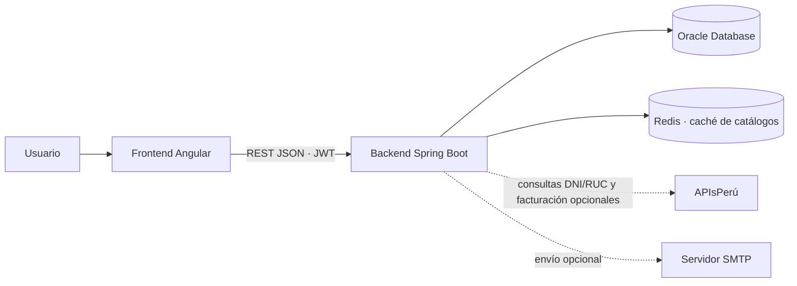

# REBOLSYS · Backend REST

API REST para la gestión del hospedaje Real Bolognesi. Conecta la aplicación Angular con Oracle y aplica las reglas de reservas, caja, ventas, inventario, seguridad y reportes.

| Dato | Valor |
|---|---|
| Versión | `0.0.1-SNAPSHOT` |
| Curso | Lenguaje de Programación II · EP Ingeniería de Sistemas · UPeU · 2026-II |
| Docente | Benjamin David Reyna Barreto |
| Integrantes | Yeremin Brian Ccapa Chacca, Esther Mariana Landa Torres, Brandon Erly Pacho Mamani, James Tequen Oncoy y Sebastian Gamarra Tarazona |
| API local | `http://localhost:8080/api/v1` |
| Aplicación web | [Frontend de REBOLSYS](../rebolsysFrontend/README.md) |

## Contenido

- [Funciones](#funciones)
- [Arquitectura y tecnologías](#arquitectura-y-tecnologías)
- [Módulos y endpoints](#módulos-y-endpoints)
- [Estructura del proyecto](#estructura-del-proyecto)
- [Requisitos y configuración](#requisitos-y-configuración)
- [Redis para catálogos](#redis-para-catálogos)
- [Actualizaciones manuales de datos](#actualizaciones-manuales-de-datos)
- [Ejecución local](#ejecución-local)
- [API y seguridad](#api-y-seguridad)
- [Manejo de errores y logs](#manejo-de-errores-y-logs)
- [Comprobantes y reportes](#comprobantes-y-reportes)
- [Despliegue](#despliegue)
- [Usuarios de prueba](#usuarios-de-prueba)
- [Pruebas y calidad](#pruebas-y-calidad)
- [Documentación y evidencias](#documentación-y-evidencias)
- [Versión e historial](#versión-e-historial)

## Funciones

- Reservas con varias habitaciones, ocupantes, pagos, ingreso, salida y cuenta de consumos.
- Ventas de productos, control de stock, pagos y comprobantes internos.
- Mantenimiento de habitaciones, mobiliario, productos y catálogos.
- Caja por turno, gastos, cierres y reportes financieros, de inventario e incidencias.
- Informes de limpieza, evidencias y tickets de mantenimiento.
- Inicio de sesión con JWT, roles, permisos funcionales y auditoría de operaciones.
- Boletas y facturas internas en PDF A4, envío manual por correo y facturación electrónica beta configurable. Los comprobantes de prueba no acreditan validez tributaria de producción.

## Arquitectura y tecnologías



| Tecnología | Uso |
|---|---|
| Java 21 · Spring Boot 4.1.1 | API y reglas de negocio |
| Spring Web MVC · Validation | Endpoints REST y validación de solicitudes |
| Spring Data JPA · Hibernate | Persistencia y validación del esquema Oracle |
| Spring Security · JJWT 0.12.6 | Autenticación y autorización con JWT |
| Spring Cache · Redis 7 | Caché de catálogos |
| Oracle JDBC | Acceso a Oracle |
| Apache PDFBox 3.0.8 · Spring Mail | PDF A4 y envío de comprobantes |
| Springdoc OpenAPI 3.1.0 | Especificación y Swagger UI en desarrollo |
| Maven Wrapper · JUnit | Construcción y pruebas automatizadas |
| JaCoCo 0.8.14 · SonarQube | Cobertura y análisis estático |

## Módulos y endpoints

Las rutas de la tabla usan el prefijo `/api/v1`. El acceso depende del rol y los permisos efectivos. Operaciones como los cobros pueden exigir condiciones adicionales, como un turno abierto.

| Módulo | Endpoint | Acceso |
|---|---|---|
| Sesión | `POST /sesion/iniciar` · `GET /sesion/actual` | Inicio público · consulta con JWT |
| Habitaciones | `GET /habitaciones` | Gerencia, `HABITACIONES:VER` o `RESERVAS:CREAR` |
| Reservas | `GET /reservas` | Gerencia o `RESERVAS:VER` |
| Estadía | `POST /reservas/detalles/{id}/ingreso` | Gerencia o `RESERVAS:REGISTRAR_INGRESO` |
| Ventas | `GET /ventas` · `POST /ventas/{id}/confirmacion` | Gerencia o, respectivamente, `VENTAS:VER` y `VENTAS:CONFIRMAR` |
| Caja | `POST /caja/turnos/{id}/cierre` | Gerencia o `CAJA:CERRAR` |
| Limpieza | `GET /limpieza/informes` · `GET /limpieza/tickets` | Gerencia o, respectivamente, `LIMPIEZA:VER_INFORMES` y `LIMPIEZA:VER_TICKETS` |
| Reportes | `GET /reportes/financiero` · `GET /reportes/incidencias` | Gerencia |

Consulta el [contrato OpenAPI](api/openapi.json) y la [guía de seguridad](API-SEGURIDAD.md) para ver los recursos de usuarios, roles y permisos.

## Estructura del proyecto

- `src/main/java/pe/com/rebolsysBackend/controller/` contiene los controladores REST.
- `service/` y `service/impl/`: contratos y lógica de negocio.
- `repository/`, `entity/` y `dto/`: persistencia y modelos de entrada/salida.
- `security/`, `config/` y `exception/` contienen la seguridad HTTP, la configuración de la aplicación y el manejo de errores.
- `src/main/resources/db/schema/`: DDL y datos SQL de referencia.
- `api/`: OpenAPI y colecciones Postman.

## Requisitos y configuración

- JDK 21.
- Oracle accesible con un esquema compatible con [`DDL_REBOLSYS_FINAL.sql`](src/main/resources/db/schema/DDL_REBOLSYS_FINAL.sql).
- Maven Wrapper incluido; no es necesario instalar Maven.
- Docker Desktop es opcional y se usa para ejecutar Redis localmente.
- APIsPerú, SMTP y facturación beta son integraciones opcionales.

Configura las variables del entorno o el archivo local ignorado `.local/application-local-private.properties`. [`.env.example`](.env.example) sirve como referencia; Spring Boot no carga ese archivo automáticamente.

| Variable | Uso |
|---|---|
| `SPRING_PROFILES_ACTIVE` | Perfil `dev` (predeterminado) o `prod` |
| `DB_URL`, `DB_USERNAME`, `DB_PASSWORD` | Conexión Oracle; obligatorias en producción |
| `SERVER_PORT` | Puerto HTTP del perfil `prod`; predeterminado `8080` |
| `JWT_SECRET` | Clave privada Base64 para firmar JWT; producción requiere al menos 32 bytes |
| `CORS_ALLOWED_ORIGINS` | Orígenes exactos del frontend |
| `REDIS_HOST`, `REDIS_PORT`, `REDIS_PASSWORD`, `REDIS_SSL` | Conexión opcional a Redis; por defecto `127.0.0.1:6380` |
| `CACHE_ENABLED`, `CACHE_PREFIX` | Habilitar caché y separar sus claves por entorno |
| `APISPERU_TOKEN` | Consulta opcional de DNI/RUC |
| `MAIL_ENABLED`, `MAIL_HOST`, `MAIL_USERNAME`, `MAIL_PASSWORD` | Envío SMTP opcional |
| `FACTURACION_HABILITADA` y `FACTURACION_APISPERU_*` | Integración electrónica beta opcional |
| `REBOLSYS_GERENTE_USUARIO`, `REBOLSYS_GERENTE_PASSWORD_TEMPORAL` | Preparación inicial de la cuenta de gerencia según la [guía de seguridad](API-SEGURIDAD.md) |

El esquema de Oracle se administra manualmente: Flyway está deshabilitado y Hibernate usa `ddl-auto=validate`. La aplicación no crea ni actualiza tablas. Verifica el DDL antes de ejecutar y no apliques scripts históricos sobre una base poblada sin revisar sus instrucciones.

Conserva `FLYWAY_ENABLED=false` en instalaciones que usan el DDL final o los scripts de `db/iteration`. El `V1` de `db/migration` corresponde a una estructura histórica. Para automatizar una instalación existente, establece primero una línea base a partir de un esquema de prueba restaurado y verifica el arranque con `ddl-auto=validate`.

Para ejecutar el DDL completo desde SQL*Plus, activa `SET SQLBLANKLINES ON` antes de cargar el archivo. Hay sentencias que contienen líneas en blanco.

## Redis para catálogos

Redis mantiene en caché algunos catálogos consultados con frecuencia. Las listas de categorías, tipos de habitación y tipos de mobiliario tienen TTL de 10 minutos; documentos, formas de pago y tipos de gasto, de 30 minutos. Las operaciones que cambian categorías o tipos invalidan su caché después de confirmar la transacción.

Desde esta carpeta, con Docker Desktop activo, inicia el servicio y comprueba que responda `PONG`:

```powershell
docker compose up -d --wait redis
docker compose exec -T redis redis-cli ping
```

El contenedor escucha internamente en `6379` y publica Redis en `127.0.0.1:6380`. Para detenerlo: `docker compose stop redis`. Si no usarás caché, configura `CACHE_ENABLED=false`. Ante una caída de Redis, las consultas continúan en Oracle; al recuperarse, el proceso descarta la caché afectada antes de reutilizarla.

## Actualizaciones manuales de datos

En un esquema vacío, ejecuta [`DDL_REBOLSYS_FINAL.sql`](src/main/resources/db/schema/DDL_REBOLSYS_FINAL.sql).
El DDL crea la estructura. Carga los catálogos y configura un usuario antes de usar la aplicación.
Si el esquema existente ya tiene V22 y V23, ejecuta [V25](src/main/resources/db/iteration/V25__alinear_ddl_final.sql)
con **Ejecutar script** (`F5`) en SQL Developer. V25 alinea la estructura y registra el tipo de movimiento
`DEVOLUCION RESERVA`.

Para configurar y probar cobros con Yape vía Mercado Pago o simulador local, consulta
[la guía de integración de Yape](API-YAPE.md).

Aplica [V22](src/main/resources/db/iteration/V22__idempotencia_salida_en_detalle_reserva.sql)
antes de iniciar esta versión sobre una base existente. Guarda la clave de
reintento y los identificadores del operador, pago y comprobante en
`DETALLE_RESERVA`. Si se aplicó el script anterior que creaba
`RESERVA_SALIDA_OPERACION`, detén el backend anterior antes de migrar. El nuevo
script copia sus registros y conserva la tabla anterior como respaldo.

[V21](src/main/resources/db/iteration/V21__estado_mobiliario_asignado.sql) corrige
los artículos que tienen habitación pero quedaron como `ACTIVO` en la carga de
datos. Ejecuta el script con la aplicación detenida, revisa los conteos por
habitación y confirma con `COMMIT`.

Para cualquier actualización manual de datos en SQL Developer, usa una hoja
no compartida por cada cambio. Ejecuta el `COMMIT` en esa misma hoja y verifica
el resultado desde otra conexión. Así evitas confirmar cambios pendientes de
otros scripts y compruebas que la aplicación ya puede ver los datos.

## Ejecución local

Configura la conexión privada a Oracle. Para probar también la caché, inicia Redis como se indicó arriba. Luego ejecuta:

```powershell
.\mvnw.cmd spring-boot:run
```

La API queda en `http://localhost:8080/api/v1`. En desarrollo, Swagger UI está en `http://localhost:8080/swagger-ui.html`; el perfil de producción desactiva la documentación OpenAPI.

Comprueba el arranque con `Invoke-RestMethod http://localhost:8080/api/health`. El campo `status` debe indicar `UP`. Usa `/actuator/health` para revisar la salud de las dependencias.

Para crear el paquete y ejecutar las pruebas automatizadas:

```powershell
.\mvnw.cmd package
```

## API y seguridad

Las operaciones funcionales requieren JWT Bearer. `GET /api/health`, `POST /api/v1/sesion/iniciar` y Swagger/OpenAPI en desarrollo están habilitados sin sesión. Los permisos se validan en el backend por funcionalidad; los datos del usuario autenticado se consultan en `/api/v1/sesion/actual`. Las operaciones exitosas se registran en `AUDITORIA_GENERAL`.

El código de seguimiento `X-Request-Id` aparece en los logs, los errores JSON y el detalle de las operaciones HTTP auditadas. `/actuator/health` y sus probes responden sin sesión. `/actuator/metrics` requiere un JWT de gerencia y está pensado para la red interna. En desarrollo, OpenAPI se sirve desde `/v3/api-docs` y [`api/openapi.json`](api/openapi.json) contiene una copia versionada del contrato.

El inicio de sesión se limita por dirección de origen y por instancia. Una respuesta `429` indica en `Retry-After` cuántos segundos esperar. Detrás de un proxy, limita también en el ingreso por cliente y configura el reenvío de IP solo desde proxies de confianza antes de usar la IP reenviada para los límites del backend.

## Manejo de errores y logs

La API devuelve el estado HTTP y un cuerpo JSON. En los errores de validación, `validationErrors` indica el problema por campo. Ejemplo de una respuesta ante un conflicto de negocio:

```json
{
  "timestamp": "2026-11-26T10:30:00",
  "status": 409,
  "error": "Conflict",
  "message": "La operación entra en conflicto con el estado actual del recurso",
  "path": "/api/v1/ventas/42/confirmacion",
  "validationErrors": null,
  "requestId": "ejemplo-42"
}
```

| Estado | Cuándo aparece |
|---|---|
| `400` | Petición inválida o datos que incumplen las validaciones |
| `401` | Autenticación ausente, inválida o vencida |
| `403` | Acceso denegado |
| `404` | Recurso o ruta inexistente |
| `409` | Conflicto con una regla de negocio o actualización concurrente |
| `429` | Límite de solicitudes de inicio de sesión |
| `500` | Error interno con mensaje genérico |

Busca el valor de `X-Request-Id` en la consola donde se ejecuta Spring Boot o en los logs del servicio. El paquete `pe.com.rebolsysBackend` usa nivel `DEBUG` en desarrollo e `INFO` en producción.

## Comprobantes y reportes

Boletas y facturas internas se generan en PDF A4; los reportes permiten imprimir en A4 horizontal o ticket de 80 mm desde el diálogo del navegador. La impresión no selecciona una impresora ni imprime sin confirmación.

La numeración conserva series como `F002-00003848` y `B002-00000001`. Los precios incluyen IGV de 18 %, que se desglosa por línea sin aumentar el total cobrado. Antes de usar las series F002/B002 en la base, revisa y aplica [`V20__series_f002_b002.sql`](src/main/resources/db/iteration/V20__series_f002_b002.sql) según sus instrucciones. Los documentos de prueba y la integración beta no tienen validez tributaria de producción.

## Despliegue

Empaqueta con `.\mvnw.cmd package` y despliega el JAR generado en `target/` en un entorno Java 21. En el servidor configura `SPRING_PROFILES_ACTIVE=prod`, las credenciales Oracle, `JWT_SECRET`, `SERVER_PORT` y los orígenes permitidos en `CORS_ALLOWED_ORIGINS`. Configura Redis solo si se habilitará la caché. Usa HTTPS en el proxy o balanceador y guarda credenciales solo en el gestor de secretos del entorno.

Antes de aplicar un cambio de esquema, genera un respaldo cifrado de Oracle y comprueba que se restaure en un esquema aislado. Para una reversión, verifica que el JAR anterior pueda arrancar contra el esquema que quedará en uso. Configura las alertas del entorno sobre disponibilidad y latencia de la API, salud de Oracle y degradación de Redis si se usa la caché.

Con el perfil y las variables de producción ya configurados, ejecuta desde el módulo:

```powershell
java -jar target/rebolsysBackend-0.0.1-SNAPSHOT.jar
```

## Usuarios de prueba

Usa un esquema de desarrollo preparado según la [guía de datos de prueba](tools/datos-prueba/README.md). La carga contempla personal con estos roles. Los accesos efectivos dependen de los permisos del esquema y de cada usuario.

| Rol | Flujo de ejemplo |
|---|---|
| `GERENTE` | Configuración, gestión de cuentas y reportes |
| `RECEPCIONISTA` | Reservas, estadías, cobros y operación de caja |
| `LIMPIEZA` | Registro y envío de informes de limpieza |
| `MANTENIMIENTO` | Revisión de informes y gestión de incidencias |

Prepara las cuentas siguiendo la [guía de seguridad](API-SEGURIDAD.md) y entrega las credenciales por un canal privado.

## Pruebas y calidad

- `.\mvnw.cmd test`: pruebas unitarias y de integración que no requieren Oracle.
- Las pruebas de Redis son optativas; activa `RUN_REDIS_TESTS=true` y consulta [`PRUEBAS-BACKEND.md`](PRUEBAS-BACKEND.md) para los comandos y requisitos.
- Las pruebas de concurrencia contra Oracle también son optativas; revisa [`PRUEBAS-BACKEND.md`](PRUEBAS-BACKEND.md) antes de ejecutarlas.

Ejecuta `./mvnw` en Unix o `.\mvnw.cmd` en Windows. En PowerShell, el siguiente comando genera también el reporte JaCoCo en `target/site/jacoco/jacoco.xml`:

```powershell
.\mvnw.cmd clean verify
```

En la línea base `v1.0-demo`, el informe de SonarQube registra **Quality Gate aprobado** y **69,2 % de cobertura** para el backend. La verificación local del 23 de noviembre documentó **288 pruebas aprobadas**, **115 omitidas** y **80,8 % de cobertura de líneas en JaCoCo**. El informe de mejora deja pendiente la publicación de las métricas oficiales de `v1.1-final`. [Guía de análisis en IntelliJ](../docs/calidad/README.md) · [Línea base](../docs/calidad/informe-mejora-rebolsys.md) · [Resultados locales](../docs/calidad/resultados-mejora-v1.1.md)

## Documentación y evidencias

- [OpenAPI](api/openapi.json) · [Colecciones de Postman](api/postman/) · [Datos de prueba](tools/datos-prueba/README.md)

- [Reglas de reservas](API-RESERVAS.md) · [Ventas](API-VENTAS.md) · [Caja](API-CAJA.md) · [Gastos](API-GASTOS.md)
- [Limpieza e incidencias](API-LIMPIEZA.md) · [Seguridad](API-SEGURIDAD.md) · [Sesión y operaciones](API-SESION-OPERACION.md)
- [Configuraciones](API-CONFIGURACIONES.md) · [Facturación electrónica beta](API-FACTURACION.md) · [Guía de DTO](DTO-GUIA.md)
- [Resultados y guía de pruebas](PRUEBAS-BACKEND.md) · [Revisión de reservas](REVISION-2026-11-21.md)

## Versión e historial

El JAR declara la versión `0.0.1-SNAPSHOT`. `v1.0-demo` identifica la línea base de SonarQube y `v1.1-final`, el análisis de seguimiento indicado en la guía de calidad. El historial de cambios del código está en Git.
