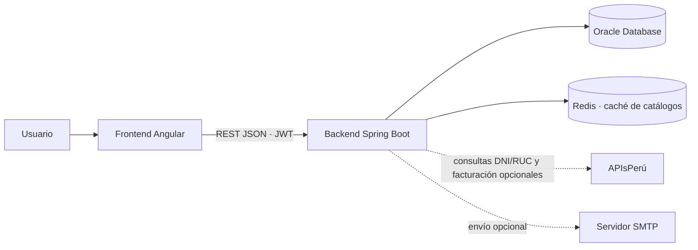

# REBOLSYS Backend

API REST para la gestión del hospedaje Real Bolognesi. Conecta la aplicación Angular con Oracle y aplica las reglas de reservas, caja, ventas, inventario, seguridad y reportes.

| Dato | Valor |
|---|---|
| Versión | `0.0.1-SNAPSHOT` |
| Curso | Lenguaje de Programación II · EP Ingeniería de Sistemas · UPeU · 2026-II |
| Docente | Benjamin David Reyna Barreto |
| Integrantes | Yeremin Brian Ccapa Chacca, Esther Mariana Landa Torres, Brandon Erly Pacho Mamani, James Tequen Oncoy y Sebastian Gamarra Tarazona |
| API local | `http://localhost:8080/api/v1` |
| Demo pública | No definida |

## Contenido

- [Funciones](#funciones)
- [Arquitectura y tecnologías](#arquitectura-y-tecnologías)
- [Estructura del proyecto](#estructura-del-proyecto)
- [Requisitos y configuración](#requisitos-y-configuración)
- [Redis para catálogos](#redis-para-catálogos)
- [Ejecución local](#ejecución-local)
- [API y seguridad](#api-y-seguridad)
- [Despliegue](#despliegue)
- [Pruebas y calidad](#pruebas-y-calidad)
- [Documentación](#documentación)

## Funciones

- Reservas con varias habitaciones, ocupantes, pagos, ingreso, salida y cuenta de consumos.
- Ventas de productos, control de stock, pagos y comprobantes internos.
- Mantenimiento de habitaciones, mobiliario, productos y catálogos.
- Caja por turno, gastos, cierres y reportes financieros, de inventario e incidencias.
- Informes de limpieza, evidencias y tickets de mantenimiento.
- Inicio de sesión con JWT, roles, permisos funcionales y auditoría de operaciones.
- Boletas y facturas internas en PDF A4, envío manual por correo y facturación electrónica beta configurable. Los comprobantes de prueba no acreditan validez tributaria de producción.

## Arquitectura y tecnologías



| Tecnología | Uso |
|---|---|
| Java 21 · Spring Boot 4.1.1 | API y reglas de negocio |
| Spring Web MVC · Validation | Endpoints REST y validación de solicitudes |
| Spring Data JPA · Hibernate | Persistencia y validación del esquema Oracle |
| Spring Security · JJWT 0.12.6 | Autenticación y autorización con JWT |
| Spring Cache · Redis 7 | Caché de catálogos |
| Oracle JDBC | Acceso a Oracle |
| Apache PDFBox 3.0.8 · Spring Mail | PDF A4 y envío de comprobantes |
| Springdoc OpenAPI 3.1.0 | Especificación y Swagger UI en desarrollo |
| Maven Wrapper | Construcción y pruebas |

### Módulos y endpoints principales

La API usa el prefijo `/api/v1`. Algunos recursos representativos:

| Recurso | Endpoints de ejemplo | Función |
|---|---|---|
| Sesión | `POST /sesion/iniciar`, `GET /sesion/actual` | Autenticación y usuario actual |
| Reservas | `GET/POST /reservas`, `POST /reservas/detalles/{id}/ingreso` | Reservas y estadía |
| Habitaciones | `GET/POST /habitaciones` | Consulta y mantenimiento |
| Ventas | `GET/POST /ventas`, `POST /ventas/{id}/confirmacion` | Venta y confirmación |
| Caja | `/caja/actual`, `/caja/turnos/{id}/cierre` | Turno, movimientos y cierre |
| Limpieza | `/limpieza/informes`, `/limpieza/tickets` | Informes e incidencias |
| Reportes | `/reportes/financiero`, `/reportes/incidencias` | Consultas e impresión |
| Seguridad | `/seguridad/usuarios`, `/seguridad/roles` | Usuarios, roles y accesos |

## Estructura del proyecto

- `src/main/java/.../controller`: controladores REST.
- `service/` y `service/impl/`: contratos y lógica de negocio.
- `repository/`, `entity/` y `dto/`: persistencia y modelos de entrada/salida.
- `security/`: autenticación, permisos, sesión y auditoría.
- `src/main/resources/db/schema/`: DDL y datos SQL de referencia.
- `api/`: OpenAPI y colecciones Postman.

## Requisitos y configuración

- JDK 21.
- Oracle accesible con un esquema compatible con [`DDL_REBOLSYS_ACTUAL.sql`](src/main/resources/db/schema/DDL_REBOLSYS_ACTUAL.sql).
- Maven Wrapper incluido; no es necesario instalar Maven.
- Docker Desktop es opcional y se usa para ejecutar Redis localmente.
- APIsPerú, SMTP y facturación beta son integraciones opcionales.

Configura las variables del entorno o el archivo local ignorado `.local/application-local-private.properties`. [`.env.example`](.env.example) sirve como referencia; Spring Boot no carga ese archivo automáticamente.

| Variable | Uso |
|---|---|
| `SPRING_PROFILES_ACTIVE` | Perfil `dev` (predeterminado) o `prod` |
| `DB_URL`, `DB_USERNAME`, `DB_PASSWORD` | Conexión Oracle; obligatorias en producción |
| `SERVER_PORT` | Puerto HTTP del perfil `prod`; predeterminado `8080` |
| `JWT_SECRET` | Clave privada Base64 para firmar JWT; producción requiere al menos 32 bytes |
| `CORS_ALLOWED_ORIGINS` | Orígenes exactos del frontend |
| `REDIS_HOST`, `REDIS_PORT`, `REDIS_PASSWORD`, `REDIS_SSL` | Conexión opcional a Redis; por defecto `127.0.0.1:6380` |
| `CACHE_ENABLED`, `CACHE_PREFIX` | Habilitar caché y separar sus claves por entorno |
| `APISPERU_TOKEN` | Consulta opcional de DNI/RUC |
| `MAIL_ENABLED`, `MAIL_HOST`, `MAIL_USERNAME`, `MAIL_PASSWORD` | Envío SMTP opcional |
| `FACTURACION_HABILITADA` y `FACTURACION_APISPERU_*` | Integración electrónica beta opcional |

El esquema de Oracle se administra manualmente: Flyway está deshabilitado y Hibernate usa `ddl-auto=validate`. La aplicación no crea ni actualiza tablas. Verifica el DDL antes de ejecutar y no apliques scripts históricos sobre una base poblada sin revisar sus instrucciones.

## Redis para catálogos

Redis mantiene en caché algunos catálogos consultados con frecuencia. Las listas de categorías, tipos de habitación y tipos de mobiliario tienen TTL de 10 minutos; documentos, formas de pago y tipos de gasto, de 30 minutos. Las operaciones que cambian categorías o tipos invalidan su caché después de confirmar la transacción.

Desde esta carpeta, con Docker Desktop activo, inicia el servicio y comprueba que responda `PONG`:

```powershell
docker compose up -d --wait redis
docker compose exec -T redis redis-cli ping
```

El contenedor escucha internamente en `6379` y publica Redis en `127.0.0.1:6380`. Para detenerlo: `docker compose stop redis`. Si no usarás caché, configura `CACHE_ENABLED=false`. Ante una caída de Redis, las consultas continúan en Oracle; al recuperarse, el proceso descarta la caché afectada antes de reutilizarla.

## Ejecución local

Configura la conexión privada a Oracle. Para probar también la caché, inicia Redis como se indicó arriba. Luego ejecuta:

```powershell
.\mvnw.cmd spring-boot:run
```

La API queda en `http://localhost:8080/api/v1`. En desarrollo, Swagger UI está en `http://localhost:8080/swagger-ui.html`; el perfil de producción desactiva la documentación OpenAPI.

Para crear el paquete y ejecutar las pruebas automatizadas:

```powershell
.\mvnw.cmd package
```

## API y seguridad

Las operaciones funcionales requieren JWT Bearer. `GET /api/health`, `POST /api/v1/sesion/iniciar` y Swagger/OpenAPI en desarrollo están habilitados sin sesión. Los permisos se validan en el backend por funcionalidad; los datos del usuario autenticado se consultan en `/api/v1/sesion/actual`. Las operaciones exitosas se registran en `AUDITORIA_GENERAL`.

El endpoint de salud es `GET /api/health`. En desarrollo, OpenAPI se sirve desde `/v3/api-docs` y [`api/openapi.json`](api/openapi.json) contiene una copia versionada del contrato.

## Comprobantes y reportes

Boletas y facturas internas se generan en PDF A4; los reportes permiten imprimir en A4 horizontal o ticket de 80 mm desde el diálogo del navegador. La impresión no selecciona una impresora ni imprime sin confirmación.

La numeración conserva series como `F002-00003848` y `B002-00000001`. Los precios incluyen IGV de 18 %, que se desglosa por línea sin aumentar el total cobrado. Antes de usar las series F002/B002 en la base, revisa y aplica [`V20__series_f002_b002.sql`](src/main/resources/db/iteration/V20__series_f002_b002.sql) según sus instrucciones. Los documentos de prueba y la integración beta no tienen validez tributaria de producción.

## Despliegue

Empaqueta con `.\mvnw.cmd package` y despliega el JAR generado en `target/` en un entorno Java 21. En el servidor configura `SPRING_PROFILES_ACTIVE=prod`, las credenciales Oracle, `JWT_SECRET`, `SERVER_PORT` y los orígenes permitidos en `CORS_ALLOWED_ORIGINS`. Configura Redis solo si se habilitará la caché. Usa HTTPS en el proxy o balanceador y guarda credenciales solo en el gestor de secretos del entorno.

No se incluyen credenciales de demostración en el repositorio. Para probar la aplicación se necesita una base preparada y un usuario habilitado en ese esquema.

## Pruebas y calidad

- `.\mvnw.cmd test`: pruebas unitarias y de integración que no requieren Oracle.
- Las pruebas de Redis son optativas; activa `RUN_REDIS_TESTS=true` y consulta [`PRUEBAS-BACKEND.md`](PRUEBAS-BACKEND.md) para los comandos y requisitos.
- Las pruebas de concurrencia contra Oracle también son optativas; revisa [`PRUEBAS-BACKEND.md`](PRUEBAS-BACKEND.md) antes de ejecutarlas.
- Los logs se escriben en la salida estándar de la aplicación. En desarrollo `pe.com.rebolsysBackend` usa nivel `DEBUG`; producción usa `INFO`. No incluyas tokens, contraseñas ni datos personales en logs o reportes de incidencias.
- El repositorio no contiene un informe ni configuración de SonarQube; no se publican métricas de calidad sin una ejecución documentada.

## Documentación

- [Reglas de reservas](API-RESERVAS.md) · [Ventas](API-VENTAS.md) · [Caja](API-CAJA.md) · [Gastos](API-GASTOS.md)
- [Limpieza e incidencias](API-LIMPIEZA.md) · [Seguridad](API-SEGURIDAD.md) · [Sesión y operaciones](API-SESION-OPERACION.md)
- [Configuraciones](API-CONFIGURACIONES.md) · [Facturación electrónica beta](API-FACTURACION.md) · [Guía de DTO](DTO-GUIA.md)
- [Resultados y guía de pruebas](PRUEBAS-BACKEND.md) · [Revisión de reservas](REVISION-2026-11-21.md)

## Versión e historial

Versión del artefacto: `0.0.1-SNAPSHOT`. No se han definido releases etiquetados. El historial de cambios está en Git.
